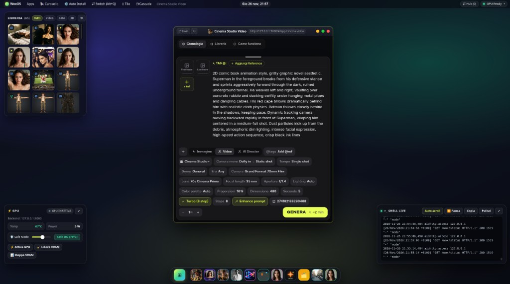
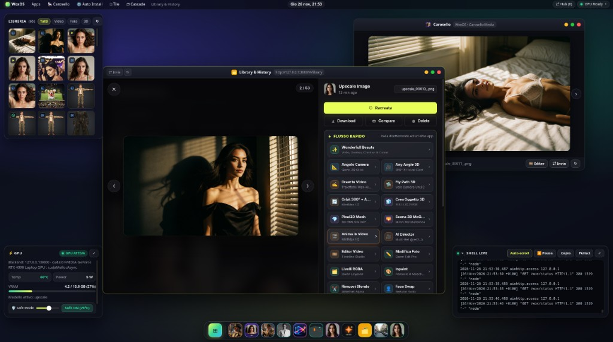
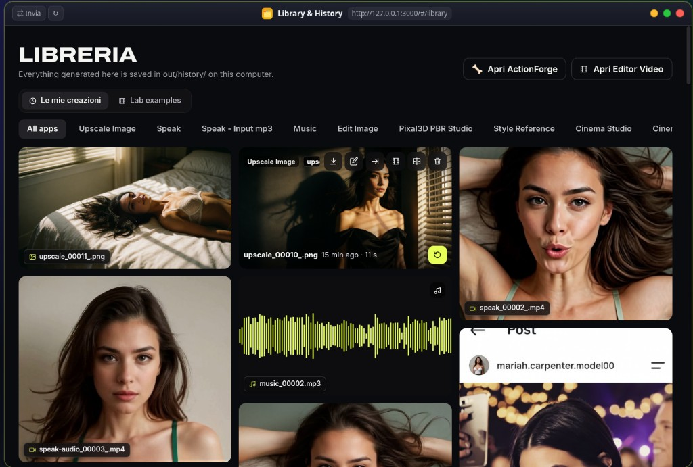
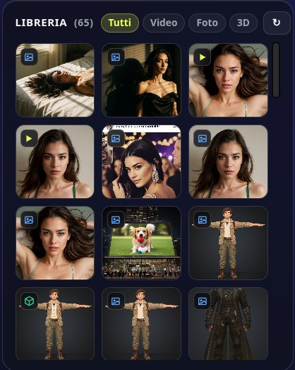
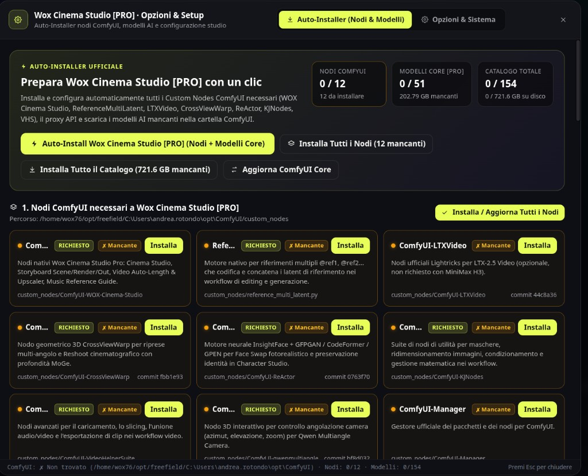

# Wox Cinema Studio PRO · **WoxOS**

<p align="center">
  <a href="#-english"><strong>🇬🇧 English</strong></a> &nbsp;·&nbsp; <a href="#-italiano"><strong>🇮🇹 Italiano</strong></a>
</p>

[](#installation)
[](#what-is-woxos)
[](#macos-style-applications-menu--drag-to-dock)
[](#installation)



---

## 🇬🇧 English

> **The 100% Local AI Desktop Operating System to create, edit, and manage Video, Images, 3D Objects, Audio, and Games — right on your machine, zero cloud and zero subscriptions.**

### What is **WoxOS**?

**Wox Cinema Studio PRO** has evolved into a full **Desktop Creative Operating System** blending **macOS + Linux + ChromeOS + Android** ergonomics, built for local AI production:

- **🎬 AI Video & Cinema** — MiniMax H3 with **Turbo LoRA 8-Step v1.2** + **INT8 Attention** (`~3× faster`), First/Last Frame control, infinite `@ref1, @ref2...` multi-reference tags, phoneme Lip-Sync (`Speak`, `Speak Audio`, `Speak Video Audio`), Orbit 360, and Reshoot.
- **🖼️ Pro Images & Retouching** — Cinema Studio Image (Krea 2 Turbo), Qwen-Image-Edit, SeedVR2 2K/4K Upscale, Multiangle 3D Camera, Wonderfull Beauty (including Wi-Fi / 4G mobile mode), Inpaint, Face Swap, and RGBA Layers.
- **🧊 3D Objects & Game Studio** — TRELLIS 3D, Pixal3D PBR Studio, Hunyuan3D 2.1, ActionForge 3D Rigging, **WOX Engine WebGL2 (Game Studio)**, and PlayCanvas 3D.
- **🎵 Audio & Music** — MiniMax Music 3 (sung tracks with lyrics), Stable Audio 3 SFX, and audio-driven lip-sync.
- **💻 Wox Code** — 100% local AI coding agent built directly into the desktop.

### Communicating Multi-Window OS (`WoxOSBus`)

Every app launches inside its own **floating window** (draggable, 8-way resizable, iconifiable to the Dock, fullscreen/maximize, `◫ Tile`, and `❐ Cascade`).

All windows communicate in real time via **`WoxOSBus`** (`BroadcastChannel` + `postMessage`):
- **Instant Cross-Window Handoff (`⇄ Send` / `⚡ Quick Flow`):** generate a clip in *Cinema Studio Video* and drop it with 1 click directly onto the *Video Studio Editor* timeline, or send any photo into *Upscale*, *TRELLIS 3D*, or *AI Director*.
- **Real-Time Live Sync:** as soon as any window finishes rendering, the Library Widget, Carousel, and all other open windows refresh automatically.
- **Full Workspace Persistence (`WoxOS → 💾 Salva Layout`):** saves all open windows, their exact positions and sizes, pinned Dock apps, desktop widget layouts, and your wallpaper — automatically restored on next startup.


### macOS-Style Applications Menu & Drag-to-Dock

The **`Applications`** launcher brings a macOS Finder experience with category sidebar (*Video & Cinema, Image & Photo, 3D & Spatial, Audio & Voice, Studios & Editors, Library & System*), real app preview thumbnails, Grid/List views, instant search, and an icon size slider.

- **Drag & Drop to the Start Bar:** grab any app from *Applications* and drop it onto the **centered bottom Dock** to pin it, drag icons to reorder, or right-click to unpin.


### Desktop Customization & Wallpapers from Your Library

**Right-click anywhere on the desktop background** to open **Desktop Options**:
- **4 built-in wallpapers** (*Aurora Nebula, Midnight Ocean, Cyber Lime, Obsidian Studio*);
- **Library Wallpaper Picker:** set any AI image you generated in your Library as your OS wallpaper in 1 click (or upload any local image);
- Instant ON/OFF toggles for all desktop widgets.


### Built-In Multi-Track Video Studio Editor

Edit generated videos directly inside WoxOS with a full multi-track timeline: transitions, effects, filters, text, captions, audio tracks, and local MP4 export. Media sent from any window lands straight on the timeline.


### Gallery Viewer, Quick Flow & Standalone Carousel App

**Library & History** opens in Gallery grid mode (or directly into the full split-screen Viewer when clicking a thumbnail in the Desktop Library Widget) with frame-by-frame controls (`-1 Frame` / `+1 Frame` / `Export Frame`), `Recreate`, `Compare`, `Download`, and **`⚡ Quick Flow`** 1-click handoff to other apps. The standalone **`🎠 Carosello`** app floats anywhere on the desktop to browse your latest outputs.





### Always-Active Desktop Widgets (Draggable & Resizable)

WoxOS ships with **3 persistent desktop widgets** (all draggable, 8-way resizable, expandable with `⤢`, and layered cleanly underneath app windows):

1. **Live Library Widget:** compact grid of your latest creations with **`All · Video · Photo · 3D`** filters, subtle SVG type badges (Video, Image, 3D `.glb`), live auto-refresh on generation complete, and 1-click open in Gallery Viewer.
2. **GPU Monitor & Safe Mode Widget:** live Temperature (`°C`), Power (`W`), VRAM progress bar, active model, clickable **`GPU ACTIVE / IDLE`** wake button, thermal **Safe Mode** slider, and **`Free VRAM`**.
3. **`>_ SHELL LIVE` Widget:** real-time colorized ComfyUI terminal right on your desktop with *Auto-scroll*, *Pause*, *Copy*, and *Clear*.




### Installation

#### Recommended Requirements
- **OS:** Linux (Ubuntu / Arch / Fedora) or Windows 10/11
- **GPU:** NVIDIA RTX with CUDA (**16 GB+ VRAM** recommended for MiniMax H3 Turbo & TRELLIS 3D)
- **Runtime:** [Node.js 22+](https://nodejs.org/), Python 3.11–3.13, Git

#### 1. Clone the repository
```bash
git clone https://github.com/wox76/wox_cinema_studio_pro.git
cd wox_cinema_studio_pro
```

#### 2. One-Click Launch

**On Linux:**
```bash
chmod +x Wox_cinema_studio_pro.sh
./Wox_cinema_studio_pro.sh
```

**On Windows:**
Double-click:
```bat
Wox_cinema_studio_pro.bat
```

The launcher installs Node.js dependencies (`npm install`), auto-detects **ComfyUI**, starts the local AI backend (`ComfyUI + Proxy + Gateway` on `:8000`), and launches **WoxOS** at:

```text
http://127.0.0.1:3000/
```

#### 3. Optimized 1-Click Auto-Installer (Nodes + Models + Turbo LoRAs)
Click **`⚙️ Auto Install`** in the top bar (or **WoxOS → ⚙️ Auto Install & Options**):
- installs all required **ComfyUI Custom Nodes** in 1 click (`ComfyUI-WOX-Cinema-Studio`, `ReferenceMultiLatent`, `CrossViewWarp`, `ReActor`, `KJNodes`, `VideoHelperSuite`, `qwenmultiangle`, `LatentSyncWrapper`, etc.);
- uses the **optimized Core pack (~110 GB instead of 205 GB+)** including **MiniMax H3 Video + Turbo LoRA 8-Step v1.2/v1.1 + lightweight NVFP4 text encoder**, Cinema Studio Image, Z-Image Turbo, Upscale SeedVR2, and Face Swap, while keeping specialized heavy packs (Qwen Edit, Audio, 3D) as 1-click optional downloads.



### Shortcuts & Quick Commands

| Shortcut / Action | Description |
| :--- | :--- |
| **`ALT + Q`** *(or `ALT + SHIFT + Q`)* | Cycle through all open WoxOS windows with visual HUD *(also `CTRL + \`, `ALT + \`, or `CTRL + TAB` in Fullscreen `F11`)* |
| **Right-click Desktop** | Open **Desktop Options** (4 Preset Wallpapers, Library Image Wallpapers, Widget toggles) |
| **Click `WoxOS` (top-left)** | Open System Menu with **`💾 Salva Layout`**, **`↺ Restore Layout`**, and **`🧹 Reset`** |
| **Drag app from `Applications` → Dock** | Pin app to the centered Start Dock (right-click Dock icon to unpin) |
| **Double-click window titlebar** | Maximize / restore window (or widget) |
| **`http://127.0.0.1:3000/?classic=1`** | Open classic web UI mode (without desktop windows) |

---

## 🇮🇹 Italiano

> **Il Sistema Operativo AI 100% Locale per creare, montare e gestire Video, Immagini, Oggetti 3D, Audio e Giochi — tutto dal tuo desktop, senza cloud e senza abbonamenti.**

### Cos'è **WoxOS**?

**Wox Cinema Studio PRO** è stato trasformato in un **vero Sistema Operativo Desktop AI** dal design ibrido (**macOS + Linux + ChromeOS + Android**) progettato interamente per la produzione multimediale locale:

- **🎬 Video AI & Cinema** — MiniMax H3 con **Turbo LoRA 8-Step v1.2** + **INT8 Attention** (`~3× più veloce`), First/Last Frame, riferimenti infiniti `@ref1, @ref2...`, Lip-Sync parlato/cantato (`Speak`, `Speak Audio`, `Speak Video Audio`), Orbit 360 e Reshoot.
- **🖼️ Immagini & Ritocco Pro** — Cinema Studio Image (Krea 2 Turbo), Qwen-Image-Edit, Upscale SeedVR2 2K/4K, Multiangle 3D Camera, Wonderfull Beauty (anche da smartphone Wi-Fi / 4G), Inpaint, Face Swap e Layer RGBA.
- **🧊 Oggetti 3D & Game Studio** — TRELLIS 3D, Pixal3D PBR Studio, Hunyuan3D 2.1, ActionForge 3D Rigging, **WOX Engine WebGL2 (Game Studio)** e PlayCanvas 3D.
- **🎵 Audio & Musica** — MiniMax Music 3 (brani cantati con testo), Stable Audio 3, e sincronizzazione labiale audio/video.
- **💻 Wox Code** — Agente di programmazione 100% locale integrato nel desktop.

### Funzionalità Principali del Sistema Operativo

- **Finestre Comunicanti (`WoxOSBus`):** ogni app si apre nella propria finestra indipendente (spostabile, ridimensionabile sugli 8 lati, riducibile a icona nel Dock, tutto schermo, `◫ Tile` e `❐ Cascade`). Invia video/immagini con 1 clic da una finestra all'altra (es. da Cinema Studio o Libreria direttamente nella timeline di **Video Studio Editor**) con aggiornamento live automatico di tutte le finestre.
- **Menu Applicazioni stile macOS Finder & Drag-to-Dock:** 185+ app divise per categoria con anteprime reali, ricerca live, vista griglia/lista e **trascinamento diretto nel Dock Start in basso** (riordinabile con drag e rimovibile con tasto destro).
- **Salvataggio Completo del Layout (`WoxOS → 💾 Salva Layout`):** salva finestre aperte, posizioni, dimensioni, app nel Dock, widget e wallpaper, ripristinando tutto automaticamente al prossimo avvio.
- **Opzioni Desktop (Tasto destro sullo sfondo):** 4 wallpaper integrati, scelta diretta di qualsiasi **immagine dalla tua Libreria** come sfondo desktop, upload dal PC e toggle rapidi dei widget.
- **3 Widget Desktop Sempre Attivi:** **Libreria Live** (`Tutti · Video · Foto · 3D` con icone SVG per tipo di file), **GPU Monitor & Safe Mode** (temperatura, Watt, barra VRAM, `Attiva GPU`, `Libera VRAM`) e **`>_ SHELL LIVE`** con log ComfyUI colorati in diretta.

### Installazione Rapida (Linux & Windows)

1. **Clona il repository:**
   ```bash
   git clone https://github.com/wox76/wox_cinema_studio_pro.git
   cd wox_cinema_studio_pro
   ```
2. **Avvia con il launcher automatico:**
   - **Linux:** `chmod +x Wox_cinema_studio_pro.sh && ./Wox_cinema_studio_pro.sh`
   - **Windows:** doppio clic su `Wox_cinema_studio_pro.bat`
3. **Apri `http://127.0.0.1:3000/`** e clicca **`⚙️ Auto Install`** nella barra in alto per installare con 1 clic tutti i Custom Nodes ComfyUI e il **pacchetto Core ottimizzato (~110 GB invece di 205+ GB)** con le nuove **MiniMax H3 Turbo LoRA 8-Step** e il text encoder leggero NVFP4.

---

## License & Credits
**Wox Cinema Studio PRO / WoxOS** integrates open-weight workflows and models for ComfyUI (MiniMax H3, LightX2V MiniMax-H3 Turbo, Krea 2, Qwen-Image-Edit, TRELLIS 3D, SeedVR2, MiniMax Music 3, Video Studio Timeline Editor). Respective model weights and custom nodes remain subject to their original authors' licenses.
