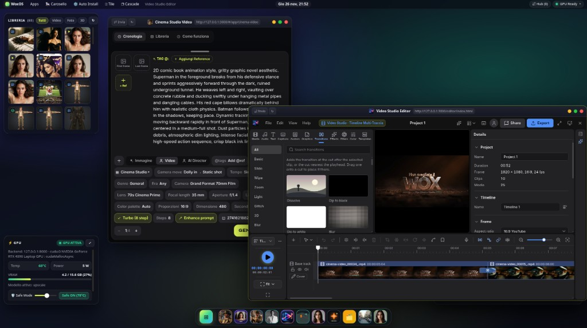
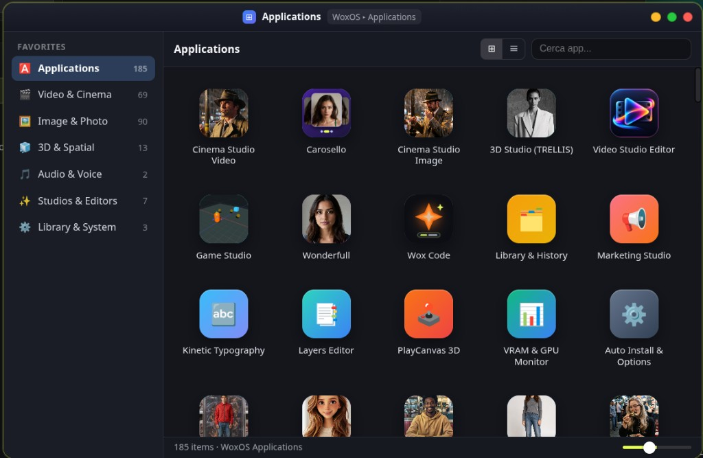
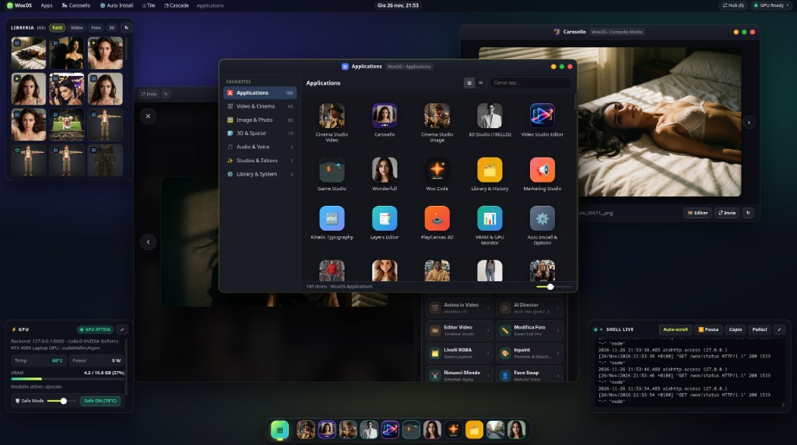
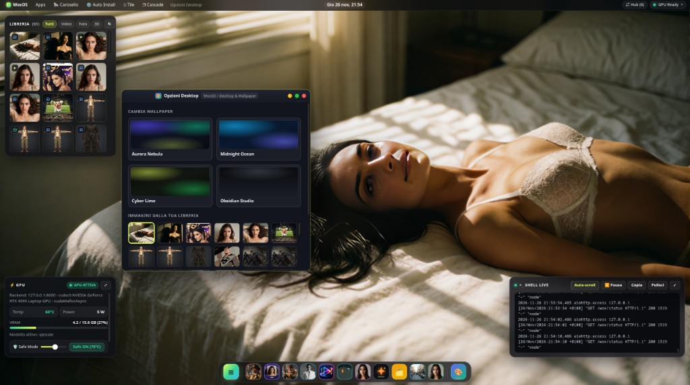
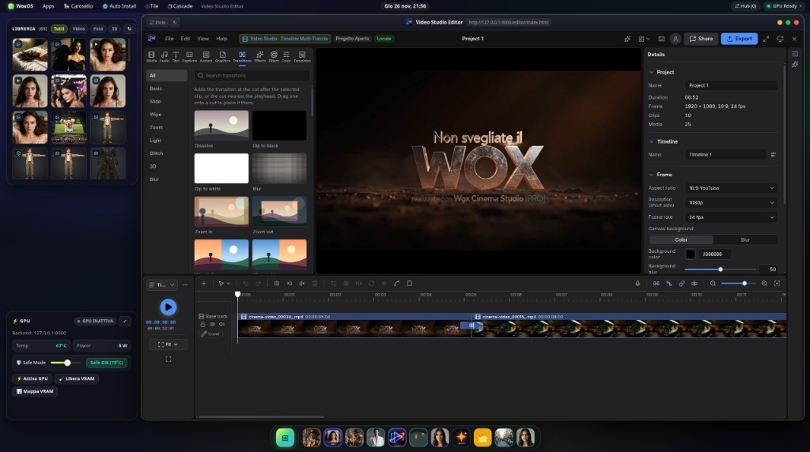
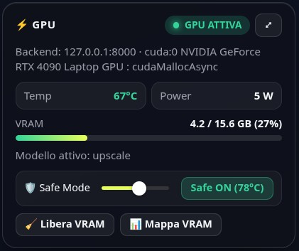

# Wox Cinema Studio PRO · **WoxOS**

> **Il Sistema Operativo AI 100% Locale per creare, montare e gestire Video, Immagini, Oggetti 3D, Audio e Giochi — tutto dal tuo desktop, senza cloud e senza abbonamenti.**

[](#installazione)
[](#motori-ai--studio-inclusi)
[](#menu-applicazioni-stile-macos--drag-to-dock)
[](#installazione)


---

## Cos'è **WoxOS**?

**Wox Cinema Studio PRO** non è più una semplice web app: è stato trasformato in un **vero Sistema Operativo Desktop AI** dal design ibrido (**macOS + Linux + ChromeOS + Android**) progettato interamente per la produzione multimediale locale:

- **🎬 Video AI & Cinema** — MiniMax H3 con **Turbo LoRA 8-Step v1.2** + **INT8 Attention** (`~3× più veloce`), First/Last Frame, riferimenti infiniti `@ref1, @ref2...`, Lip-Sync parlato/cantato, Orbit 360 e Reshoot.
- **🖼️ Immagini & Ritocco Pro** — Cinema Studio Image (Krea 2 Turbo), Qwen-Image-Edit, Upscale SeedVR2 2K/4K, Multiangle 3D Camera, Wonderfull Beauty (anche da smartphone Wi-Fi / 4G), Inpaint, Face Swap e Layer RGBA.
- **🧊 Oggetti 3D & Game Studio** — TRELLIS 3D, Pixal3D PBR Studio, Hunyuan3D 2.1, ActionForge 3D Rigging, **WOX Engine WebGL2 (Game Studio)** e PlayCanvas 3D.
- **🎵 Audio & Musica** — MiniMax Music 3 (brani cantati con testo), Stable Audio 3, e sincronizzazione labiale audio/video.
- **💻 Wox Code** — Agente di programmazione 100% locale integrato nel desktop.

---

## Multitasking a Finestre Comunicanti (`WoxOSBus`)

Ogni applicazione si apre nella propria **finestra indipendente** (spostabile, ridimensionabile sugli 8 lati, riducibile a icona nel Dock, tutto schermo, `◫ Tile` affiancato e `❐ Cascade`).

Tutte le finestre comunicano in tempo reale attraverso **`WoxOSBus`** (`BroadcastChannel` + `postMessage`):
- **Invio diretto tra finestre (`⇄ Invia` / `⚡ Flusso Rapido`):** genera un video in *Cinema Studio Video* e mandalo con un clic direttamente nella timeline di *Video Studio Editor*, oppure manda una foto in *Upscale*, *TRELLIS 3D* o *AI Director*.
- **Sincronizzazione live:** appena una finestra termina un render, il Widget Libreria, Carosello e tutte le altre finestre aperte si aggiornano istantaneamente.
- **Salvataggio completo del Layout (`WoxOS → 💾 Salva Layout`):** salva tutte le finestre aperte, posizione, dimensioni, app fissate nel Dock, widget e wallpaper, ripristinando esattamente la tua postazione al riavvio successivo.



---

## Menu Applicazioni stile macOS & Drag-to-Dock

Il launcher **`Applications`** riprende l'eleganza del Finder di macOS con sidebar categorie (*Video & Cinema, Image & Photo, 3D & Spatial, Audio & Voice, Studios & Editors, Library & System*), anteprime reali delle app, vista Griglia/Lista, ricerca istantanea e slider dimensione icone.

- **Drag & Drop sulla barra Start:** trascina qualsiasi app dal menu *Applications* direttamente sul **Dock centrato in basso** per fissarla, riordina le icone trascinandole o fai tasto destro per rimuoverle.





---

## Personalizzazione Desktop & Wallpaper dalla tua Libreria

Fai **tasto destro sullo sfondo del desktop** per aprire **`Opzioni Desktop`**:
- **4 Wallpaper integrati** (*Aurora Nebula, Midnight Ocean, Cyber Lime, Obsidian Studio*);
- **Immagini dalla tua Libreria:** imposta qualsiasi immagine generata con l'AI come sfondo del sistema operativo con un solo clic (oppure carica un file dal PC);
- Interruttori rapidi ON/OFF per mostrare o nascondere i widget desktop.



---

## Video Studio Editor Multi-Traccia Integrato

Monta subito i video generati senza uscire da WoxOS: timeline multi-traccia, transizioni, effetti, filtri, testo, sottotitoli, tracce audio ed export MP4 locale. I media inviati da qualsiasi finestra (Libreria, Galleria, Carosello o Cinema Studio) entrano direttamente in timeline.



---

## Galleria Viewer, Flusso Rapido & App Carosello

La finestra **Library & History (Galleria)** apre i tuoi media in grande con controlli fotogramma per fotogramma (`-1 Frame` / `+1 Frame` / `Esporta Frame`), `Recreate`, `Compare`, `Download` e il pannello **`⚡ Flusso Rapido`** per rilanciare ogni output verso un'altra app in un clic. L'app dedicata **`🎠 Carosello`** è una finestra flottante che puoi posizionare dove preferisci sul desktop per scorrere le ultime generazioni.


---

## Widget Desktop Sempre Attivi (Spostabili & Ridimensionabili)

WoxOS include **3 widget desktop persistenti** (tutti spostabili, ridimensionabili sugli 8 lati e con tasto `⤢` tutto schermo, sempre posizionati ordinatamente sotto le finestre):

1. **Widget Libreria Live:** griglia compatta delle tue ultime creazioni con filtri **`Tutti · Video · Foto · 3D`**, badge SVG discreti per tipo di file (Video, Immagine, Oggetto 3D `.glb`), aggiornamento automatico al termine di ogni generazione e apertura diretta in Galleria al clic.
2. **Widget GPU Monitor & Safe Mode:** telemetria in tempo reale di Temperatura (`°C`), Assorbimento (`W`), barra VRAM usata/totale, modello attivo, pulsante **`GPU ATTIVA / INATTIVA`** cliccabile per svegliare la GPU, **Safe Mode termico** con slider soglia e **`Libera VRAM`**.
3. **Widget `>_ SHELL LIVE`:** console ComfyUI in diretta sul desktop con colori per errori/warning/progress bar, *Auto-scroll*, *Pausa*, *Copia* e *Pulisci*.




---

## Installazione

### Requisiti minimi consigliati
- **OS:** Linux (Ubuntu / Arch / Fedora) oppure Windows 10/11
- **GPU:** NVIDIA RTX con CUDA (**16 GB+ VRAM** consigliati per MiniMax H3 Turbo & TRELLIS 3D)
- **Runtime:** [Node.js 22+](https://nodejs.org/), Python 3.11–3.13, Git

### 1. Clona il repository
```bash
git clone https://github.com/wox76/wox_cinema_studio_pro.git
cd wox_cinema_studio_pro
```

### 2. Avvio Rapido (Launcher Automatico)

**Su Linux:**
```bash
chmod +x Wox_cinema_studio_pro.sh
./Wox_cinema_studio_pro.sh
```

**Su Windows:**
Fai doppio clic su:
```bat
Wox_cinema_studio_pro.bat
```

Lo script installa automaticamente le dipendenze Node.js (`npm install`), rileva la tua installazione di **ComfyUI**, avvia il backend locale (`ComfyUI + Proxy + Gateway` sulla porta `:8000`) e l'interfaccia **WoxOS** su:

```text
http://127.0.0.1:3000/
```

### 3. Auto-Installer 1-Clic (Nodi ComfyUI + Modelli AI + Turbo LoRA)
Una volta aperto WoxOS, clicca su **`⚙️ Auto Install`** nella barra in alto (oppure **WoxOS → ⚙️ Auto Install & Opzioni**):
- installa con un clic tutti i **Custom Nodes ComfyUI** necessari (`ComfyUI-WOX-Cinema-Studio`, `ReferenceMultiLatent`, `CrossViewWarp`, `ReActor`, `KJNodes`, `VideoHelperSuite`, `qwenmultiangle`, ecc.);
- scarica automaticamente i **modelli AI** e le **MiniMax H3 Turbo LoRA 8-Step** (`fl2v v1.2` + `ref2v v1.1`) nelle cartelle corrette di ComfyUI;
- permette di configurare i percorsi di ComfyUI, il token HuggingFace (opzionale per pack gated) e le opzioni di sistema.


---

## Scorciatoie & Comandi Rapidi di WoxOS

| Comando / Azione | Funzione |
| :--- | :--- |
| **`ALT + Q`** *(o `ALT + SHIFT + Q`)* | Cicla tra tutte le finestre aperte con HUD centrale *(anche `CTRL + \`, `ALT + \` o `CTRL + TAB` in Fullscreen `F11`)* |
| **Tasto destro sullo sfondo desktop** | Apre **Opzioni Desktop** (Wallpaper preset, Wallpaper dalla Libreria, toggle Widget) |
| **Click su `WoxOS` (in alto a sinistra)** | Apre il Menu di Sistema con **`💾 Salva Layout`**, **`↺ Ripristina Layout`** e **`🧹 Reset`** |
| **Trascina un'app da `Applications` → Dock** | Fissa l'app nella barra Start in basso (tasto destro sull'icona nel Dock per rimuoverla) |
| **Doppio clic sulla barra titolo** | Massimizza / ripristina la finestra (o il widget) |
| **`http://127.0.0.1:3000/?classic=1`** | Apre la vista web classica (senza desktop a finestre) |

---

## Licenza & Crediti
Il codice di **Wox Cinema Studio PRO / WoxOS** integra workflow e modelli open-weight per ComfyUI (MiniMax H3, LightX2V MiniMax-H3 Turbo, Krea 2, Qwen-Image-Edit, TRELLIS 3D, SeedVR2, MiniMax Music 3, Video Studio Timeline Editor). I rispettivi pesi e nodi restano soggetti alle licenze dei loro autori originali.
