<div align="center">

# 🎬 Wox Cinema Studio [PRO]

**Next-Generation Local AI Cinema Production Suite, Multi-Reference Director, 120+ One-Click AI Apps & Integrated Multi-Track Video Timeline Editor — Powered by ComfyUI**

[](#-english-documentation)
[](#-documentazione-in-italiano)
[](https://github.com/comfyanonymous/ComfyUI)
[](LICENSE)

<p align="center">
  <a href="#-english-documentation"><b>🇬🇧 English Documentation</b></a> •
  <a href="#-documentazione-in-italiano"><b>🇮🇹 Documentazione in Italiano</b></a> •
  <a href="#-1-click-auto-installer-nodes--models"><b>⚙️ 1-Click Auto-Installer</b></a> •
  <a href="#-quick-start"><b>🚀 Quick Start</b></a>
</p>

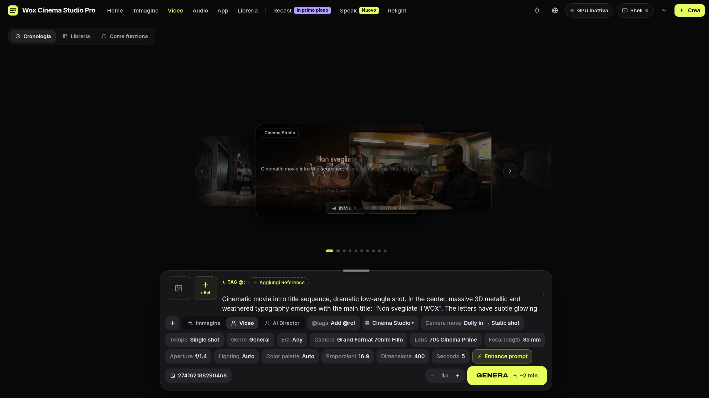

</div>

---

# 🇬🇧 English Documentation

## ✨ Overview

**Wox Cinema Studio [PRO]** is a complete, local-first AI filmmaking and visual production platform built on top of **ComfyUI**. It replaces complex spaghetti node graphs with a sleek, Hollywood-grade studio interface featuring:

- **🎥 Cinema Studio [PRO] (Image, Video & AI Director)**: Shoot with virtual cinema cameras (*Grand Format 70mm Film*, *Modular 8K Digital*, *16mm Bolex*, *Vintage Anamorphic*), real cinema lenses, focal lengths (`14mm`–`200mm`), apertures (`f/1.4`–`f/11`), 50+ choreographed camera moves, lighting rigs, color palettes, and **infinite `@ref1, @ref2...` multi-reference conditioning** powered by our custom `ReferenceMultiLatent` engine.
- **🎞️ Integrated Video Studio · Multi-Track Timeline Editor**: A dockable and expandable non-linear video editor (NLE) built directly into the bottom of the workspace with multi-track video/audio layers, transitions, keyframing, transform & blend modes, color grading, and 1-click import from any generation.
- **⚡ Fluid Handoff ("Flusso Rapido" & "Send To...") & Frame-Exact Export**: Step through generated videos frame-by-frame (`-1 Frame` / `+1 Frame`), extract exact PNG frames, and pipe any output directly into `AI Director`, `Editor Video Timeline`, `Upscale Video`, `Extend Video`, `Face Swap ReActor`, or `BiRefNet Background Removal` in a single click.
- **🧩 120+ One-Click AI Apps**: Curated pipelines for Text/Image-to-Video (**LTX-2.3 22B**, **Wan 2.2 14B**), Image Generation & Editing (**FLUX.2 Klein 9B/4B**, **Qwen Image Edit 2511**, **Z-Image Turbo**), Identity & Character Consistency (**ReActor Face Swap**, **Character Studio**, **PuLID**), Camera & 3D Re-shooting (**CrossViewWarp**, **MoGe**), Video Upscaling (**SeedVR2 3B**), and Audio/Music (**MiniMax Music 1.5**, **Stable Audio**, **Whisper + F5-TTS Dubbing**).
- **⚙️ 1-Click Auto-Installer (Nodes & Models)**: Built-in settings & installer manager (`⚙️` gear icon in the top bar) that automatically clones, updates, and installs all required ComfyUI custom nodes and downloads missing AI model packs from Hugging Face with real-time progress logs.
- **🛡️ GPU Safe Mode (Anti-Overheat), Live ComfyUI Shell & VRAM Map**: Hardware thermal protection daemon (`75°C / 78°C / 82°C` ceiling), real-time ComfyUI execution terminal in the browser, and a phase-by-phase VRAM usage map across all workflows.

---

## 📸 Visual Tour

### 1. Cinema Studio [PRO] — Video & Image Composers
Full cinematographic control over cameras, prime/anamorphic lenses, focal lengths, apertures, camera movements, multi-reference `@ref` tags, and prompt enhancement.

| Cinema Studio — Video Workspace | Cinema Studio — Image Workspace |
| :---: | :---: |
|  | 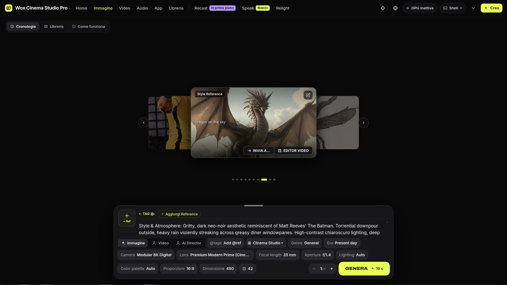 |

---

### 2. Explore 120+ AI Apps & 50+ Choreographed Camera Moves
Browse and search specialized apps across **Image**, **Video**, and **Audio** categories, with instant previews and camera choreography controls (`Dolly in → Static shot`, `Orbit`, `FPV Drone`, `Whip Pan`, `Vertigo Zoom`, `Bullet Time`, and more).

| Image Apps Catalog & Search | Video Apps Catalog & Camera Moves |
| :---: | :---: |
| 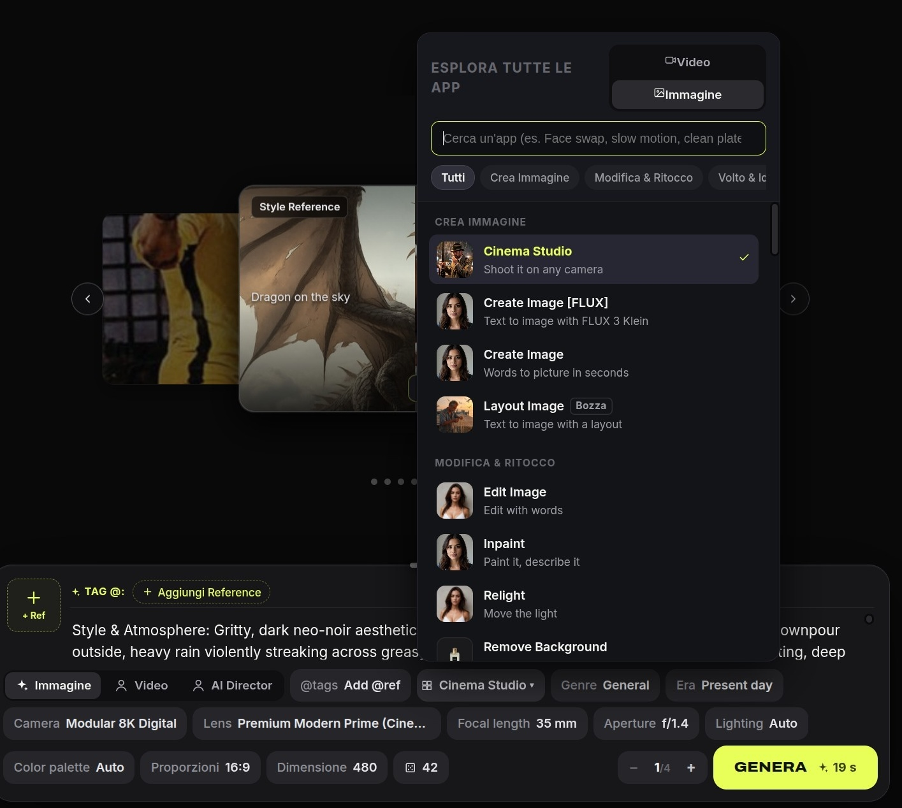 | 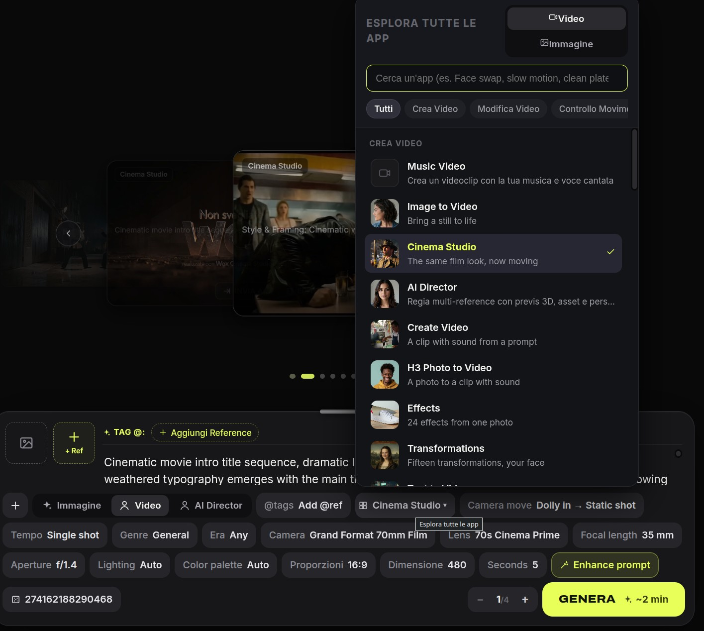 |

---

### 3. Integrated Video Studio — Multi-Track Timeline Editor
Open the **Video Studio** drawer from the top bar at any time to assemble scenes on a multi-track timeline, apply transitions, adjust transform/opacity/blending, mix audio tracks, and export your final cut without leaving the browser.

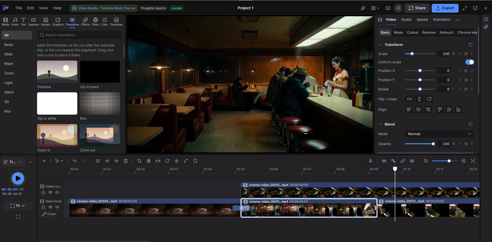

---

### 4. Frame-Exact Player, Fluid Handoff ("Flusso Rapido") & "Send To..."
Inspect every generation with frame-accurate stepping (`-1 Frame`, `+1 Frame`, `Esporta Frame`) and route any video or extracted frame directly into another AI workflow or into the Video Studio timeline.

| Frame-by-Frame Inspector (`-1 / +1 Frame`, `Export Frame`) | Fluid Handoff ("Flusso Rapido") Sidebar |
| :---: | :---: |
| 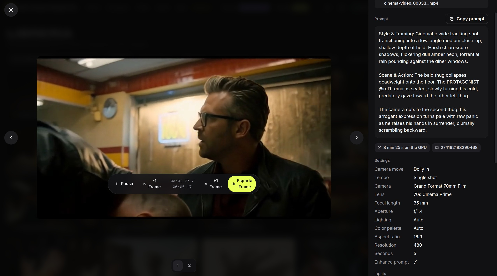 | 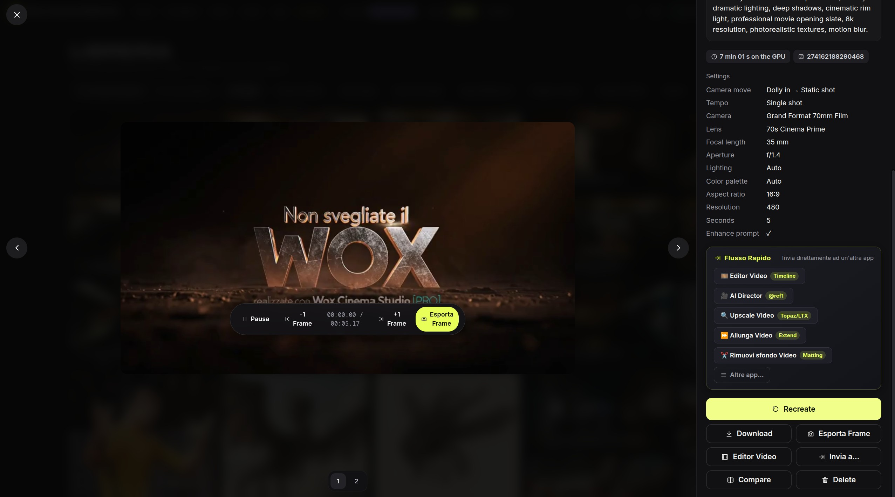 |

<div align="center">
  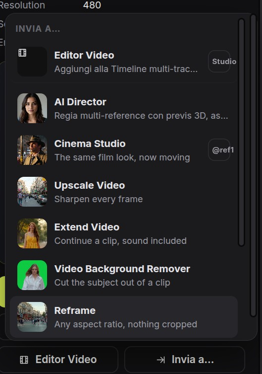
  <p><i>One-click "Send To..." context menu for chaining AI pipelines together.</i></p>
</div>

---

### 5. Live ComfyUI Terminal, GPU Safe Mode & Phase-by-Phase VRAM Map
Monitor your GPU in real time, stream ComfyUI console logs directly inside the web UI, enforce thermal power limits so long video renders never overheat your GPU, and inspect exact VRAM requirements per workflow stage.

| Live ComfyUI Terminal & Execution Monitor | GPU Safe Mode (Anti-Overheat) & Multi-Language UI |
| :---: | :---: |
| 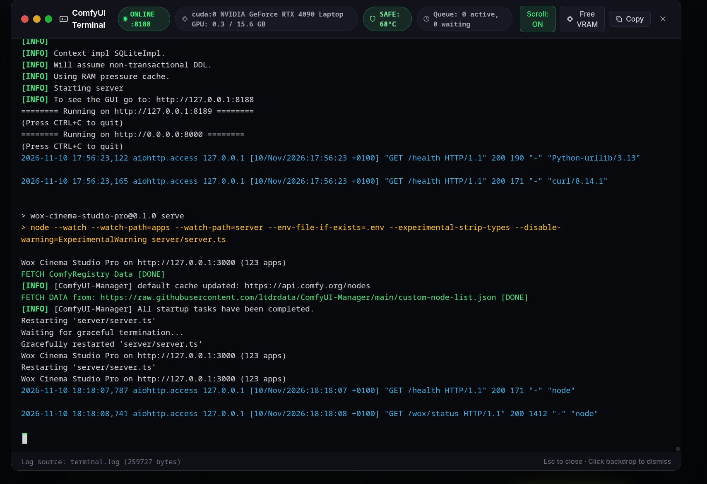 | 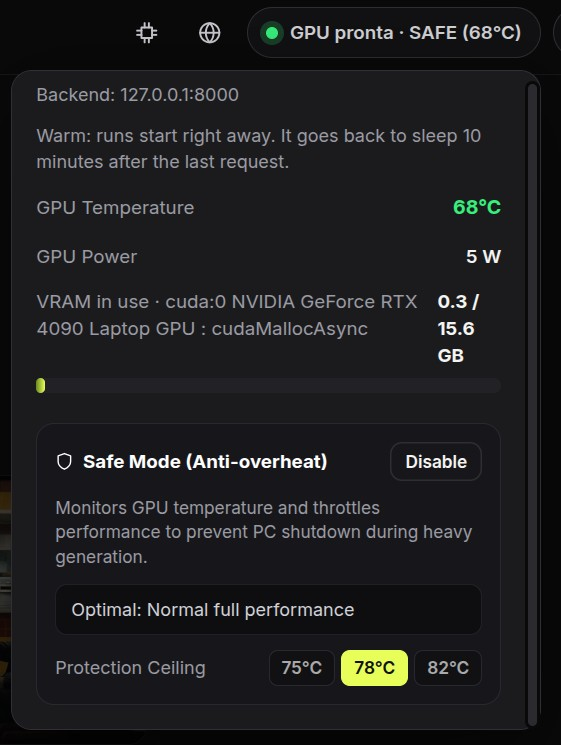<br/><br/>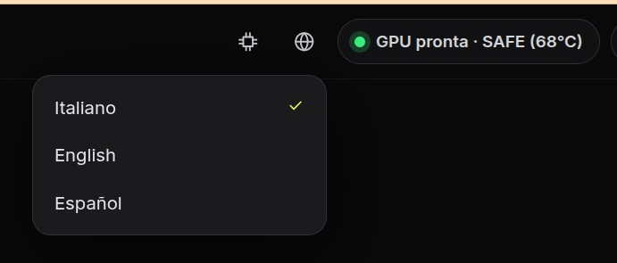 |

#### 📊 Phase-by-Phase VRAM Map
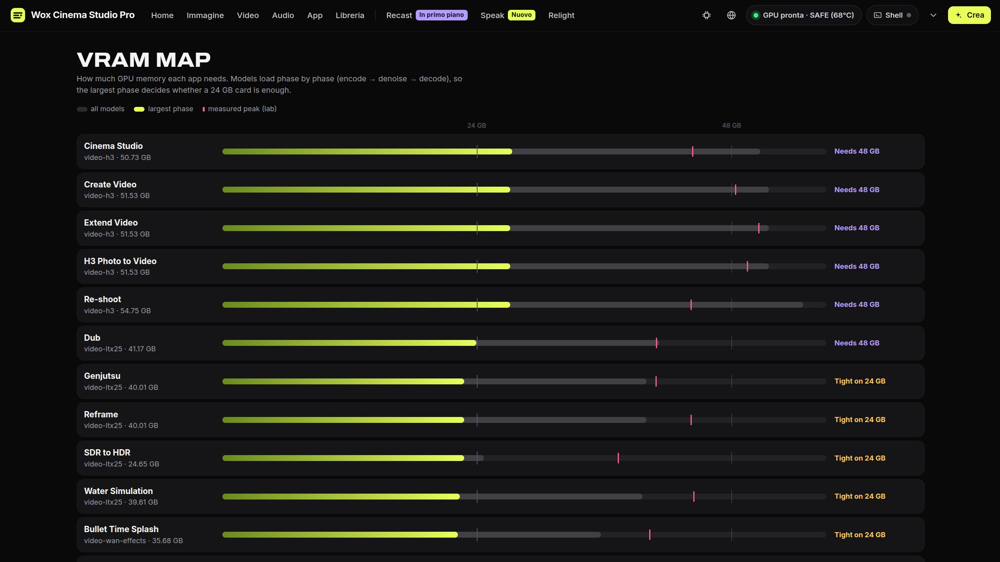

---

## ⚙️ 1-Click Auto-Installer (Nodes & Models)

Located in the top navigation bar between **Video Studio · Editor Video Timeline** and **Create (`+ Crea`)**, the **⚙️ Options & Auto-Installer** button opens a dedicated management center with 4 tabs:

1. **🚀 Auto-Installer (1-Click)**:
   - **Install All Essentials (Nodes + Core Models)**: Automatically installs all 9 required ComfyUI custom nodes, syncs bundled **Wox Cinema Studio** nodes (`ComfyUI-WOX-Cinema-Studio` and `reference_multi_latent.py`), creates compatibility symlinks, and downloads the core model packs (**FLUX.2 Klein 9B**, **LTX-2.3 22B Video & Audio**, **Whisper + F5-TTS**).
   - **Install Full Catalog (All Nodes + All 14 Model Packs)**: Installs every node and every model pack for all 120+ apps.
   - **Install Only Custom Nodes**: Quickly installs/updates all ComfyUI custom nodes and their Python `requirements.txt`.
2. **🧩 Custom Nodes (ComfyUI)**:
   - Live status badge (`Installed` / `Missing`) and individual 1-click install/update buttons for:
     - `ComfyUI-WOX-Cinema-Studio` *(bundled in `custom_nodes/`)*
     - `reference_multi_latent.py` *(bundled in `custom_nodes/`)*
     - `ComfyUI-LTXVideo`
     - `ComfyUI-MelBandRoFormer`
     - `ComfyUI-GGUF`
     - `ComfyUI-SeedVR2_VideoUpscaler`
     - `ComfyUI-ReActor`
     - `ComfyUI-BiRefNet-ZHO`
     - `ComfyUI-Frame-Interpolation`
3. **📦 AI Models (Hugging Face)**:
   - Grouped into 14 model packs (`Core` & `Optional`) with disk size, file count, and per-pack or per-file download buttons.
4. **🔧 Options**:
   - Configure `COMFYUI_DIR`, `PYTHON_BIN`, Hugging Face Token (`HF_TOKEN`) for gated repositories, UI language (`Italiano`, `English`, `Español`), and GPU Safe Mode thermal limits.

---

## 🚀 Quick Start

### Prerequisites
- **Linux** (Ubuntu/Debian/Arch) with an **NVIDIA GPU** (16 GB+ VRAM recommended; 24 GB+ ideal for full 22B video pipelines)
- **Node.js 20+** & **npm**
- **Python 3.10–3.12** with a functioning **ComfyUI** installation

### 1. Clone the Repository
```bash
git clone https://github.com/wox76/wox_cinema_studio_pro.git
cd wox_cinema_studio_pro
npm install
```

### 2. Launch Wox Cinema Studio [PRO]
You can start the entire stack (ComfyUI + Local Prompt Enhancement Gateway + Web Server + Thermal Daemon) using the included launcher script:
```bash
chmod +x Wox_cinema_studio_pro.sh
./Wox_cinema_studio_pro.sh
```
Or start the web server directly:
```bash
COMFY_URL=http://127.0.0.1:8188 npm start
```
Then open **`http://localhost:3000`** in your browser, click the **⚙️ (Options & Auto-Installer)** icon in the top-right bar, and click **Install All Essentials (Nodes + Core Models)**.

---
---

# 🇮🇹 Documentazione in Italiano

## ✨ Panoramica

**Wox Cinema Studio [PRO]** è una suite completa di produzione cinematografica IA locale basata su **ComfyUI**. Sostituisce la complessità dei grafi a nodi con un'interfaccia da studio cinematografico professionale che integra:

- **🎥 Cinema Studio [PRO] (Immagine, Video & AI Director)**: Gira le tue scene scegliendo cineprese virtuali (*Grand Format 70mm Film*, *Modular 8K Digital*, *16mm Bolex*, *Anamorfico Vintage*), lenti cinematografiche reali, lunghezze focali (`14mm`–`200mm`), aperture di diaframma (`f/1.4`–`f/11`), oltre 50 movimenti di macchina coreografati, schemi di illuminazione, palette colore e **condizionamento multi-reference infinito (`@ref1, @ref2...`)** tramite il nodo nativo `ReferenceMultiLatent`.
- **🎞️ Video Studio Integrato · Editor Video Timeline Multi-Traccia**: Un editor video non-lineare (NLE) richiamabile in qualsiasi momento nella parte inferiore dello schermo, completo di timeline multi-traccia (video, audio, testo), transizioni, controlli di trasformazione e fusione (*Blend Mode*), keyframing, color grading e importazione con 1 clic da qualsiasi generazione.
- **⚡ Flusso Rapido ("Invia a...") & Controllo Frame-by-Frame**: Analizza i video generati fotogramma per fotogramma (`-1 Frame` / `+1 Frame`), esporta il singolo frame perfetto (`Esporta Frame`) e invia istantaneamente qualsiasi risultato a `Editor Video`, `AI Director @ref1..5`, `Upscale Video`, `Allunga Video`, `Face Swap ReActor` o `Rimuovi sfondo BiRefNet`.
- **🧩 Oltre 120 App IA Pronte all'Uso**: Pipeline ottimizzate per Video (**LTX-2.3 22B**, **Wan 2.2 14B**), Immagini (**FLUX.2 Klein 9B/4B**, **Qwen Image Edit 2511**, **Z-Image Turbo**), Identità e Coerenza Personaggio (**ReActor Face Swap**, **Character Studio**, **PuLID**), Regia 3D e Camera (**CrossViewWarp**, **MoGe**), Restauro e Upscaling (**SeedVR2 3B**) e Musica/Doppiaggio (**MiniMax Music 1.5**, **Stable Audio**, **Whisper + F5-TTS**).
- **⚙️ Auto-Installer 1-Click (Nodi & Modelli)**: Pannello opzioni e installazione automatica (icona ingranaggio **`⚙️`** nella barra superiore, tra *Video Studio* e *Crea*) che installa tutti i custom node di ComfyUI e scarica automaticamente tutti i modelli IA necessari con log in tempo reale.
- **🛡️ GPU Safe Mode (Anti-Surriscaldamento), Terminale ComfyUI Live & Mappa VRAM**: Protezione termica attiva della GPU (tetto configurabile `75°C / 78°C / 82°C`), console live di ComfyUI integrata nel browser e mappa dettagliata del consumo VRAM fase per fase.

---

## 📸 Galleria Funzionalità

### 1. Cinema Studio [PRO] — Workspace Video & Immagine
Controllo totale su cinepresa, ottiche cinematografiche, focale, apertura, movimenti di camera, tag `@ref` multipli e miglioramento automatico del prompt (*Enhance prompt*).

| Workspace Video — Cinema Studio | Workspace Immagine — Cinema Studio |
| :---: | :---: |
|  |  |

---

### 2. Esplora Tutte le App & Movimenti di Macchina
Cerca e filtra tra oltre 120 app suddivise per categorie (**Immagine**, **Video**, **Audio**) e seleziona movimenti di camera cinematografici (`Dolly in → Static shot`, `Orbit`, `FPV Drone`, `Whip Pan`, `Vertigo Zoom`, `Bullet Time`, ecc.).

| Catalogo App Immagine | Catalogo App Video & Movimenti Camera |
| :---: | :---: |
|  |  |

---

### 3. Video Studio — Editor Video Timeline Multi-Traccia
Apri o espandi il **Video Studio** dalla barra in alto per montare le tue clip su più tracce video e audio, applicare transizioni, regolare scala/posizione/rotazione/opacità e finalizzare il montaggio direttamente nell'app.


---

### 4. Player Frame-by-Frame, Flusso Rapido & Menu "Invia a..."
Controlla la riproduzione con precisione al singolo fotogramma (`-1 Frame`, `+1 Frame`, `Esporta Frame`) e concatena più strumenti IA in sequenza tramite i pulsanti rapidi di **Flusso Rapido** o il menu **"Invia a..."**.

| Controlli Frame (`-1 / +1 Frame`, `Esporta Frame`) | Flusso Rapido & Dettagli Telecamera |
| :---: | :---: |
|  |  |

<div align="center">
  
  <p><i>Menu contestuale "Invia a..." per inviare qualsiasi creazione o frame ad altre app o alla Timeline Video.</i></p>
</div>

---

### 5. Terminale ComfyUI Live, GPU Safe Mode & Mappa VRAM
Monitora in tempo reale lo stato della scheda video, leggi i log di esecuzione di ComfyUI senza uscire dal browser, imposta il limite termico anti-surriscaldamento e consulta la mappa della VRAM per ogni fase della pipeline.

| Terminale Live ComfyUI & Monitor Esecuzione | GPU Safe Mode (Anti-Overheat) & Selettore Lingua |
| :---: | :---: |
|  | <br/><br/> |

#### 📊 Mappa della VRAM Fase per Fase


---

## ⚙️ Auto-Installer 1-Click (Nodi & Modelli)

Accanto ai pulsanti **Video Studio** e **Crea (`+ Crea`)** nella barra superiore, il pulsante **⚙️ (Opzioni & Auto-Installer)** permette di configurare e installare automaticamente tutto il necessario per far partire **Wox Cinema Studio [PRO]**:

1. **🚀 Auto-Installer (1-Click)**:
   - **Installa Tutto Essenziale (Nodi + Modelli Core)**: Installa tutti i 9 custom node richiesti in ComfyUI, sincronizza i nodi nativi inclusi nel repository (`ComfyUI-WOX-Cinema-Studio` e `reference_multi_latent.py`), crea i symlink di compatibilità e scarica i pacchetti modelli base (**FLUX.2 Klein 9B**, **LTX-2.3 22B Video & Audio**, **Whisper + F5-TTS**).
   - **Installa Catalogo Completo (Tutti i Nodi + Tutti i 14 Pack)**: Scarica tutti i modelli per tutte le oltre 120 app del catalogo.
   - **Installa Solo i Nodi ComfyUI**: Clona/aggiorna rapidamente tutti i custom node e installa le relative dipendenze Python (`requirements.txt`).
2. **🧩 Nodi Custom (ComfyUI)**:
   - Stato in tempo reale (`Installato` / `Mancante`) e installazione singola con 1 clic per `ComfyUI-WOX-Cinema-Studio`, `reference_multi_latent.py`, `ComfyUI-LTXVideo`, `ComfyUI-MelBandRoFormer`, `ComfyUI-GGUF`, `ComfyUI-SeedVR2_VideoUpscaler`, `ComfyUI-ReActor`, `ComfyUI-BiRefNet-ZHO` e `ComfyUI-Frame-Interpolation`.
3. **📦 Modelli IA (Hugging Face)**:
   - Elenco completo dei 14 pacchetti di modelli divisi tra `Essenziali (Core)` e `Opzionali`, con stato di presenza su disco e pulsante di download per singolo pacchetto o singolo file.
4. **🔧 Opzioni**:
   - Configurazione del percorso `COMFYUI_DIR`, dell'eseguibile Python `PYTHON_BIN`, del token Hugging Face (`HF_TOKEN`), della lingua dell'interfaccia (`Italiano`, `English`, `Español`) e del tetto termico **GPU Safe Mode**.

---

## 🚀 Avvio Rapido

### Requisiti
- **Linux** con scheda video **NVIDIA** (consigliati almeno 16 GB di VRAM; 24 GB+ ideali per le pipeline video 22B complete)
- **Node.js 20+** & **npm**
- **Python 3.10–3.12** con un'installazione di **ComfyUI**

### 1. Clona il Repository
```bash
git clone https://github.com/wox76/wox_cinema_studio_pro.git
cd wox_cinema_studio_pro
npm install
```

### 2. Avvia Wox Cinema Studio [PRO]
Puoi avviare l'intero ambiente (ComfyUI + Gateway locale per i prompt + Server Web + Protezione Termica GPU) con lo script incluso:
```bash
chmod +x Wox_cinema_studio_pro.sh
./Wox_cinema_studio_pro.sh
```
Oppure avviare direttamente il server web:
```bash
COMFY_URL=http://127.0.0.1:8188 npm start
```
Apri **`http://localhost:3000`** nel browser, clicca sull'icona dell'ingranaggio **⚙️ (Opzioni & Auto-Installer)** in alto a destra accanto a *Crea* e premi **Installa Tutto Essenziale (Nodi + Modelli Core)**.

---

## 📁 Struttura del Progetto / Project Structure

```text
wox_cinema_studio_pro/
├── apps/                        # 120+ AI app definitions & ComfyUI workflow builders
├── custom_nodes/                # Bundled ComfyUI custom nodes:
│   ├── ComfyUI-WOX-Cinema-Studio/   # Visual Director, Storyboard & Multi-Shot nodes
│   └── reference_multi_latent.py    # Infinite @ref1..@refN latent conditioning node
├── editor/                      # Multi-track Video Studio Timeline Editor source (React/Vite/Pixi)
├── server/                      # Node.js TypeScript backend:
│   ├── server.ts                # HTTP API, SSE progress stream & static server
│   ├── installer.ts             # 1-Click Auto-Installer for ComfyUI nodes & HF models
│   ├── comfy.ts                 # ComfyUI WebSocket/HTTP execution client
│   ├── history.ts               # Local library & generation manager
│   └── thermal.ts               # GPU Safe Mode anti-overheat daemon
├── web/                         # Frontend Studio UI (ES Modules, zero-build fast reload)
│   ├── js/                      # Workspace, Cinema Studio composer, Settings/Installer UI
│   └── editor/                  # Compiled Video Studio Timeline Editor bundle
├── screenshot/                  # Official UI screenshots for documentation
└── Wox_cinema_studio_pro.sh     # All-in-one desktop/CLI launcher
```

---

## 📄 License / Licenza

Released under the [MIT License](LICENSE).
